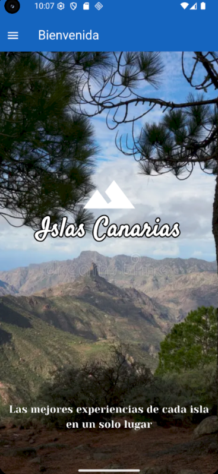
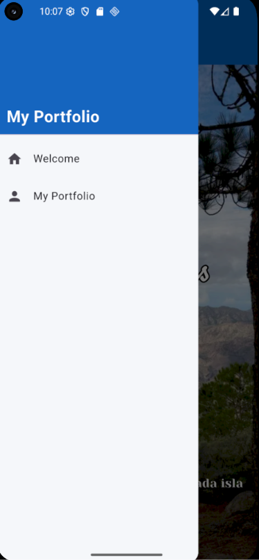
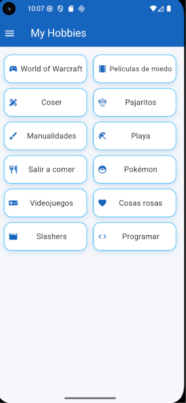

# 🌴 Canarias Explorer — My Portfolio

Aplicación móvil desarrollada con **Flutter** como proyecto académico. Combina una presentación personal con una interfaz inspirada en las Islas Canarias, utilizando fotografías, tarjetas personalizadas y una navegación sencilla entre las diferentes pantallas.

## ✨ Características principales

- 🏝️ **Pantalla de bienvenida:** imagen de fondo relacionada con las Islas Canarias, título con tipografía personalizada y el mensaje «Un paraíso por descubrir».
- 🧭 **Navegación mediante Drawer:** menú lateral para acceder a las distintas secciones de la aplicación.
- 👤 **Portfolio personal:** presentación del usuario y apartados personalizados.
- 🎮 **Mis hobbies:** tarjetas con iconos y bordes redondeados para mostrar los intereses personales.
- 💻 **Repositorio:** sección dedicada al repositorio online, con una tarjeta personalizada y un código QR para facilitar el acceso.
- 🎨 **Diseño personalizado:** combinación de colores, imágenes y tipografías para conseguir una interfaz visualmente atractiva.
- 📱 **Diseño adaptable:** interfaz desarrollada con los componentes de Flutter.

## 🛠️ Tecnologías utilizadas

| Tecnología | Uso |
|---|---|
| Flutter | Desarrollo de la interfaz |
| Dart | Lenguaje de programación |
| Material Design | Componentes visuales |
| `go_router` | Navegación entre pantallas |
| `google_fonts` | Tipografías personalizadas |
| Git y GitHub | Control de versiones y alojamiento del código |

## 🎨 Diseño de la aplicación

La aplicación utiliza una estética visual inspirada en las Islas Canarias, con fotografías de paisajes, elementos gráficos y una distribución organizada de los contenidos.

Se presta especial atención a la legibilidad, la organización de las pantallas, las tarjetas con bordes redondeados y la coherencia visual entre las diferentes secciones.

## 📂 Estructura del proyecto

```text
PGL-P2-MyPortfolio/
├── assets/
│   └── images/
│       └── welcome_background.webp
├── lib/
│   ├── main.dart
│   ├── widgets/
│       └── app_drawer.dart
|       └── app_router.dart
|       └── portfolio_page.dart
|       └── welcome_page.dart
│   
├── pubspec.yaml
└── README.md
```

## 🚀 Instalación y ejecución

### Requisitos previos

- Tener instalado Flutter y Dart.
- Disponer de un editor compatible, como Visual Studio Code o Android Studio.
- Tener Git instalado para clonar el repositorio.

### Pasos

1. Clonar el repositorio:

   ```bash
   git clone https://github.com/usr4324-art/P2-Tarea1-Navegacion
   ```

2. Acceder a la carpeta del proyecto:

   ```bash
   cd PGL-P2-MyPortfolio
   ```

3. Instalar las dependencias:

   ```bash
   flutter pub get
   ```

4. Ejecutar la aplicación:

   ```bash
   flutter run
   ```

## 🌿 Control de versiones

El proyecto utiliza Git para gestionar los cambios mediante ramas de trabajo. Las funcionalidades se desarrollan y revisan antes de integrarse en las ramas principales.

## 🎯 Objetivo del proyecto

El objetivo es desarrollar una aplicación Flutter que permita practicar la creación de interfaces, la organización del código en componentes reutilizables, la navegación entre pantallas y el uso de recursos gráficos, integrando una presentación personal con una temática visual relacionada con las Islas Canarias.

---

## 📸 Capturas de pantalla

### Pantalla de bienvenida



### Pantalla Drawer



### Pantalla My Hobbies



**Desarrollado con Flutter 💙🏝️**
